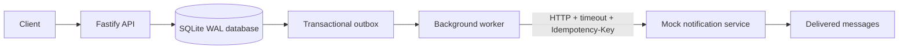

# Workshop Registration and Notifications

Workshop Registration and Notifications is a backend service for creating workshops, registering members, and delivering confirmation and cancellation notifications reliably.

The project demonstrates the **transactional outbox pattern** with Fastify, TypeScript, SQLite, and a separate mock notification service. The API responds to registrations without waiting for notification delivery. A background worker delivers notifications with leases, retries, timeouts, and idempotency keys.

## Architecture



The backend API and outbox worker run in the same Node.js process. The mock notification service runs as a separate process and can simulate errors, delays, timeouts, and complete outages.

## Why the outbox pattern?

A registration and its confirmation notification must not become inconsistent. The service therefore writes both records in one database transaction:

1. Insert the registration.
2. Insert its confirmation notification into the outbox.
3. Commit both changes together.
4. Return the registration response immediately.
5. Let the background worker deliver the notification later.

If the transaction fails, neither the registration nor its notification is stored. If the backend crashes before delivery, the outbox record remains in SQLite and can be retried after restart.

## Technology

- Node.js 20+
- TypeScript with strict type checking
- Fastify
- SQLite with WAL mode
- `better-sqlite3`
- Zod request and environment validation
- Vitest
- `tsx` for development and the demo

## Getting started

### Requirements

- Node.js 20 or newer
- npm

### Install

```sh
npm install
cp .env.example .env
```

The `data` directory and SQLite database are created automatically when the backend starts.

### Start the services

Build the TypeScript source first:

```sh
npm run build
```

Start the mock notification service in one terminal:

```sh
npm run mock
```

Start the backend in a second terminal:

```sh
npm start
```

The services use these default addresses:

- Backend API: `http://localhost:3000`
- Mock notifier: `http://localhost:4000`

For development, use `npm run dev` instead of `npm start`. The development command runs the backend with TypeScript watch mode.

### Windows PowerShell

If PowerShell blocks `npm.ps1`, use `npm.cmd`:

```powershell
Copy-Item .env.example .env
npm.cmd install
npm.cmd run build
npm.cmd run mock
npm.cmd start
```

Run the mock service and backend in separate terminals.

## Configuration

Configuration is loaded from environment variables. The defaults are suitable for local development.

| Variable | Default | Description |
|---|---:|---|
| `API_KEY` | `change-me` | API key required for organizer endpoints |
| `PORT` | `3000` | Backend API port |
| `MOCK_PORT` | `4000` | Mock notifier port |
| `DATABASE_PATH` | `./data/workshops.db` | SQLite database path |
| `NOTIFIER_URL` | `http://localhost:4000` | Mock notifier base URL |
| `WORKER_CONCURRENCY` | `4` | Maximum number of notifications delivered concurrently |
| `POLL_INTERVAL_MS` | `250` | Worker polling interval |
| `LEASE_DURATION_MS` | `1500` | Duration of an outbox claim lease |
| `NOTIFY_TIMEOUT_MS` | `1000` | HTTP timeout for one notification attempt |
| `MAX_ATTEMPTS` | `5` | Attempts allowed before a notification becomes `DEAD` |
| `BACKOFF_BASE_MS` | `250` | Initial retry backoff |
| `BACKOFF_MAX_MS` | `30000` | Maximum retry backoff |
| `ERROR_RATE` | `0` | Mock service HTTP error probability from `0` to `1` |
| `TIMEOUT_RATE` | `0` | Mock service timeout probability from `0` to `1` |
| `DELAY_MS` | `0` | Additional mock service response delay |

## API

Organizer endpoints require the header:

```text
x-api-key: change-me
```

### Create a workshop

```sh
curl -X POST http://localhost:3000/workshops \
  -H 'x-api-key: change-me' \
  -H 'content-type: application/json' \
  -d '{
    "title": "TypeScript Backend",
    "description": "Building reliable Node.js services",
    "capacity": 25,
    "startsAt": "2030-01-01T10:00:00.000Z"
  }'
```

Response:

```json
{
  "id": "WORKSHOP_UUID",
  "title": "TypeScript Backend",
  "description": "Building reliable Node.js services",
  "capacity": 25,
  "startsAt": "2030-01-01T10:00:00.000Z",
  "cancelled": false
}
```

### Register a member

Registration does not wait for notification delivery.

```sh
curl -X POST http://localhost:3000/workshops/WORKSHOP_UUID/register \
  -H 'content-type: application/json' \
  -d '{
    "memberId": "member-1",
    "email": "member@example.com"
  }'
```

The same member can register only once for a workshop. Capacity and cancellation rules are enforced before the registration transaction commits.

### List registrations

```sh
curl http://localhost:3000/workshops/WORKSHOP_UUID/registrations \
  -H 'x-api-key: change-me'
```

### Cancel a workshop

```sh
curl -X POST http://localhost:3000/workshops/WORKSHOP_UUID/cancel \
  -H 'x-api-key: change-me'
```

Cancellation marks the workshop as cancelled and creates one cancellation notification for every registered member in the same transaction.

### Inspect notifications

List all outbox records:

```sh
curl http://localhost:3000/notifications \
  -H 'x-api-key: change-me'
```

Filter by status:

```sh
curl 'http://localhost:3000/notifications?status=DEAD' \
  -H 'x-api-key: change-me'
```

Supported statuses are `PENDING`, `IN_PROGRESS`, `SENT`, and `DEAD`.

Requeue dead notifications:

```sh
curl -X POST http://localhost:3000/notifications/requeue \
  -H 'x-api-key: change-me'
```

### HTTP status codes

| Status | Meaning |
|---:|---|
| `201` | Workshop or registration created |
| `400` | Invalid request body, email, UUID, or query parameter |
| `401` | Missing or invalid organizer API key |
| `404` | Workshop not found |
| `409` | Duplicate registration, full workshop, cancelled workshop, or repeated cancellation |

## Mock notification service

The mock service exposes the following endpoints:

| Method | Endpoint | Purpose |
|---|---|---|
| `POST` | `/notify` | Receives a notification from the worker |
| `POST` | `/admin/down` | Makes the service unavailable |
| `POST` | `/admin/up` | Restores the service |
| `GET` | `/received` | Shows delivered messages and duplicate attempts |

Example:

```sh
curl http://localhost:4000/received
```

```json
{
  "count": 2,
  "duplicates": 1,
  "messages": [
    {
      "idempotencyKey": "confirm:1",
      "recipient": "member@example.com",
      "type": "CONFIRMATION"
    }
  ]
}
```

The mock service treats the `Idempotency-Key` header as the message identity. Repeated attempts with the same key are counted as duplicates and are not added to the delivered message list.

## Reliability model

### Transactional writes

Registration and its confirmation outbox row are written in one SQLite transaction. Cancellation and all cancellation outbox rows are written in one transaction. This prevents a successful registration without a corresponding notification record.

The database enforces uniqueness for both registrations and notification idempotency keys:

```text
UNIQUE(workshopId, memberId)
UNIQUE(idempotencyKey)
```

### Leases and crash recovery

The worker claims due rows by changing them to `IN_PROGRESS` and assigning a `lockedUntil` lease inside a database transaction. A row is eligible when it is:

- `PENDING` and its `nextAttemptAt` has passed, or
- `IN_PROGRESS` and its lease has expired.

The worker polls immediately on startup, so expired leases are recovered after a backend restart. A crash can cause a notification to be sent more than once, but it cannot silently lose the durable outbox record.

### Retries and dead letters

Each notification is delivered independently. HTTP failures, non-2xx responses, and timeouts increment the attempt count and schedule a retry using capped exponential backoff with jitter. Once `MAX_ATTEMPTS` is reached, the row becomes `DEAD` and retains its last error. An organizer can inspect dead rows and requeue them.

### At-least-once delivery

The delivery guarantee is at-least-once, not exactly-once. The worker sends the same idempotency key on every attempt:

```text
Idempotency-Key: confirm:123
```

The receiving service can use that key to deduplicate messages. Exactly-once delivery cannot be guaranteed across independent processes and network failures without cooperation from the receiver.

### Failure isolation

The worker processes claimed rows concurrently up to the configured limit. A failure for one recipient is caught and recorded for that row only; other recipients continue processing.

## Testing

Run the test suite:

```sh
npm test
```

The tests cover duplicate registration, failed registration, transaction rollback, retry delivery, recipient isolation, cancellation fan-out, repeated cancellation, expired lease recovery, idempotency handling, dead-letter transitions, and requeue behavior.

Validate the TypeScript build:

```sh
npm run build
```

Run the end-to-end demonstration:

```sh
npm run demo
```

The demo starts compiled child processes and demonstrates normal confirmation delivery, notifier outage and recovery, backend termination with `SIGKILL`, lease-based restart recovery, and cancellation delivery. A successful run ends with:

```text
FINAL RESULT: PASS
```

## Project structure

```text
src/
  api/              Fastify HTTP routes and request validation
  db/               SQLite schema and transactional data access
  mock-notifier/    Mock notification service
  worker/           Outbox polling and delivery worker
  config.ts         Environment configuration
  server.ts         Backend process entry point
scripts/
  demo.ts           End-to-end reliability demonstration
tests/
  app.test.ts       API, database, worker, and mock service tests
```

## Production considerations

SQLite and polling keep this project easy to run locally and make the reliability behavior visible. For a multi-instance production deployment, I would move the transactional data to Postgres and use `SELECT ... FOR UPDATE SKIP LOCKED` or a broker-backed queue for scalable claiming. I would also add metrics for queue depth, delivery latency, retry counts, dead-letter volume, and duplicate delivery, along with stronger organizer authentication and service-to-service authentication.

The core trade-off remains the same: at-least-once delivery with idempotency is robust and practical, while exactly-once delivery is not a realistic promise at the network boundary.
